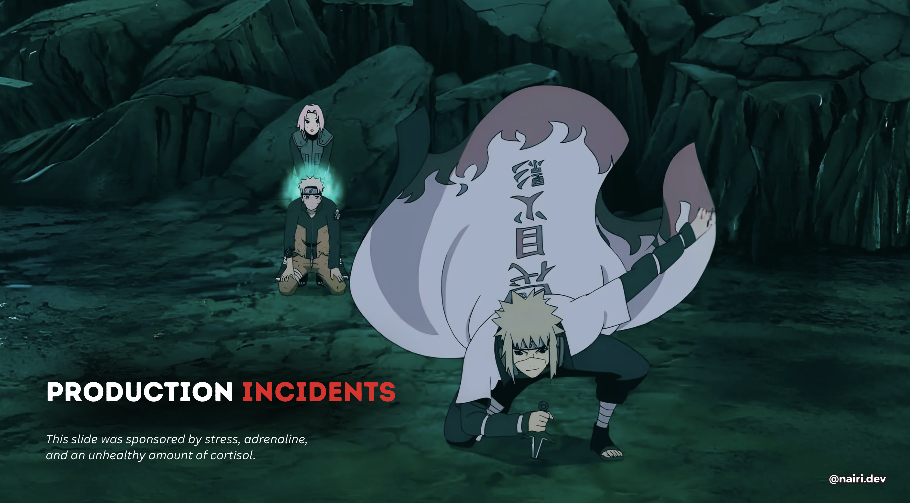

# iJS Munich 2026 — Conference Slides

Slides from my talk at **iJS Munich 2026**:

## Production Incidents Without Data Loss: Lessons from Real Systems

A look at our journey handling production incidents and the practices we've adopted to make recovery easier, reduce the risk of data loss, and maintain consistency in distributed systems.

### 📄 Presentation

**[View / download the slides (PDF)](./ijs-munich-2026-slides.pdf)**

### 🔗 Connect with me

- **Website:** [nairi.dev](https://nairi.dev/)
- **Medium:** [nairihar.medium.com](https://nairihar.medium.com/)

---

*Presented at iJS Munich 2026.*

## Related Articles

If you're interested in the production engineering and Node.js topics discussed in this talk, here are three related articles I've written:

| | | |
|:---:|:---:|:---:|
|  |  |  |
| **[Node.js EventLoop Lag + Kafka Consumer Lag: One Root Cause](https://nairihar.medium.com/node-js-eventloop-lag-kafka-consumer-lag-one-root-cause-89465672de13)** | **[An Advanced Retry Mechanism in Node.js with Kafka](https://nairihar.medium.com/an-advanced-retry-mechanism-in-node-js-with-kafka-36741142c693)** | **[You Don’t Know Node.js EventLoop](https://nairihar.medium.com/you-dont-know-node-js-eventloop-8ee16831767)** |
| The 3-second production mystery that took me 20 days to solve. | Reliable event delivery with an easy-to-monitor approach. | The ultimate guide to understanding the EventLoop in Node.js. |
